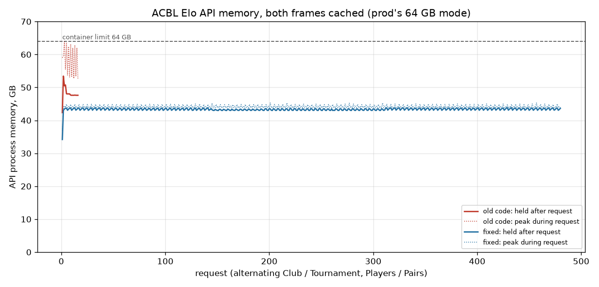

# ACBL Elo API: memory when visitors switch between Club and Tournament

Investigated 2026-11-25 on dev (P620-5995WX-1) in a Linux container set up
like prod's `acbl-api`: image `elo-ratings` with prod's pins (polars 2.0.0,
duckdb 2.0.0, pyarrow 25.0.1), 64 GB memory limit, `MALLOC_ARENA_MAX=2`,
`ACBL_CONTAINER_MEMORY_GB=64`, the data folder bind-mounted from Windows. Data:
the new-formula Elo files in `E:\bridge\data\acbl` (club 74.0M rows, 102
columns, 4.2 GB parquet; tournament 19.0M rows, 89 columns, 1.4 GB). The old
files in `elo_backup_20261125_before_new_formula` have the same shape and size
(4.21 GB and 1.39 GB), so the numbers apply to them too.

## Summary

There was no slow leak. Two things made memory climb toward the limit:

1. **Every request converted the whole cached frame to Arrow.**
   `_prepare_self_view` did `con.register("_full", full_df)` with the Polars
   frame. DuckDB turns a Polars frame into Arrow by calling `to_arrow()` at
   the oldest compat level, which copies every string view into a
   `large_string` array and rebuilds every dictionary: **+13.7 GB and 7 to
   11 s for each Club request** (2 to 4 s for Tournament), freed when the
   request ends. After a request
   1.6 to 8 GB of it stayed with the allocator, varying from request to
   request.
2. **The cached frames were far bigger than the code assumed.** The club frame
   held **42.2 GB**, not the ~13 GB the budget code expected
   (`estimated_size()` said 26.3 GB). Each Polars String is a 16-byte view per
   row however short the value, so each of the ten remaining String columns
   took 1.1 GB (74M rows x 16 bytes) and `ParContracts` (a list of structs of
   four strings) took 7.3 GB, while `estimated_size()` reported 0.04 to 1.6 GB
   for them. Tournament held 12.3 GB.

With the 64 GB limit the server keeps both frames (the dual-frame cache turns
on at 40 GB): 42.2 + 12.3 = 54.5 GB resident, and one Club request's 13.7 GB
conversion pushes the container past 64 GB. That is the climb people saw when
switching: the first switch loads the second frame, and each request after it
adds its transient peak on top. In the first HTTP trial (old code) the
container reached its limit on the third request and stalled in reclaim.

`malloc_trim` and `MALLOC_ARENA_MAX` could not help: Polars and DuckDB each
link their own jemalloc, so glibc's malloc holds almost none of this memory.
Polars already sets `_RJEM_MALLOC_CONF=dirty_decay_ms:500,muzzy_decay_ms:1000`;
forcing decay to 0 (`background_thread:true,dirty_decay_ms:0,muzzy_decay_ms:0`)
returned only 1.8 GB of the 42 GB after a club load. Neither the frame cache
nor the persistent connection was keeping stale frames: frames are replaced,
not accumulated, and the per-request connection reset frees DuckDB's buffers.

## How it was found

`scripts/acbl_api_memory_probe.py` loads a frame as the server does and calls
the `/acbl/report` handler in process, printing the process's anonymous memory
after each step. Measured on the club frame:

| Step | Anonymous memory |
|---|---|
| After load (old code) | 42.2 GB (`estimated_size` 26.3 GB) |
| Same, jemalloc decay forced to 0 | 40.4 GB |
| After `rechunk()` (one chunk per column instead of 617) | 39.8 GB |
| After dropping every String and List column | 23.0 GB (`estimated_size` 22.3 GB) |
| `full_df.to_arrow()` (what DuckDB's register does) | +13.7 GB, 19.8 s |
| `full_df.to_arrow(compat_level=newest)` | +1.9 GB, 18.5 s |

Dropping columns one at a time showed where the 19 GB gap was: 1.06 to
1.14 GB for each of `Declarer_Direction`, `Lead`, `mp_limit`, `BidSuit`,
`Declarer_Pair_Direction`, `SD_Lead_Best_Card`, `Direction_OnLead`, `OnLead`,
`strata_bucket`, and 7.30 GB for `ParContracts`. These columns have 3 to
~170K distinct values (`ParContracts` 8,400 distinct lists).

Registering the newest-compat Arrow table instead of the frame: register
+0.0 GB, and memory after three request-sized queries was flat at 43.95 GB
(the frame path: 43.9 to 50.3 GB after each of five rounds).

## The fix (acbl_api_server.py)

1. **Every String column, and every String field inside a list or struct, is
   Categorical** in the cached frame (`_dtype_shrink_exprs`, applied in the
   lazy plan so the String version is never resident). Before, only
   `Player_Name_*`, `Player_ID_*` and tournament `session_id` were.
2. **The frame's Arrow export is made once at load**
   (`to_arrow(compat_level=pl.CompatLevel.newest())`, cached in
   `_ARROW_CACHE`, dropped on eviction with the frame) and `_prepare_self_view`
   registers that table. It shares the frame's buffers.
3. The size estimates used for the memory budget (`_estimated_frame_bytes`,
   the DuckDB budget's club default) are the measured ones: club 34 GB,
   tournament 10 GB.

DuckDB reads the dictionary columns as VARCHAR, so the favorites SQL and
user SQL behave as before: `Declarer_Direction = 'N'`, comparisons with values
that do not occur, `||` concatenation and
`list_transform(ParContracts, lambda p: p.Strain)` all give the old answers,
and results come back as String (`test_acbl_api_memory.py`). The reports of
the old and new code are identical for Club and Tournament, Players and Pairs,
except `Clone_Elo` and `Partner_Effect` on Players: the clone fit is not
deterministic in the old code either (two runs of the unchanged code differ in
26 and 62 cells of those two columns; its fitted scale moves between 290.74
and 290.93), because DuckDB runs with `preserve_insertion_order=false` on 8
threads and the fit depends on row order.

Polars-side code that needs text casts to Utf8 first already
(`acbl_results_url_expr`, the platinum filter, crossover ids), and
`strata_bucket == bucket` works on Categorical.

## Before and after

### Latency and memory per request, in process

`acbl_api_memory_probe.py` in single-frame mode (`ACBL_DUAL_FRAME_CACHE=0`),
two passes each of old and new code, alternating; each pass is five Club
Players (all time), three Club Pairs (last year), then five Tournament Players
and three Tournament Pairs. Warm medians, seconds (dev was busy with other
sessions' jobs, so passes differ by up to 1.6x):

| Request | Old, pass 1 / 2 | New, pass 1 / 2 | of which: register step old -> new |
|---|---|---|---|
| Club Players | 48.6 / 55.9 | 38.1 / 32.0 | 10.9-11.4 -> 0.07 |
| Club Pairs, last year | 16.0 / 26.5 | 11.3 / 7.5 | 7.0-10.8 -> 0.06 |
| Tournament Players | 10.3 / 16.4 | 9.9 / 6.9 | 2.4-3.7 -> 0.05 |
| Tournament Pairs, last year | 6.6 / 10.1 | 5.3 / 3.3 | 2.4-3.7 -> 0.05 |
| Load (once): club | 17-22 | 38-58 | Arrow export 28 s |
| Load (once): tournament | ~5 | ~20 | Arrow export 15 s |

The SQL and crossover steps take about the same time in both; the
difference is the register step. The one-time Arrow export makes a cold load
20 to 35 s slower; with the dual-frame cache (prod's 64 GB) that happens once
per frame after a restart.

Resident (anonymous) memory between requests:

| | Old | New |
|---|---|---|
| Club frame cached | 42.0-42.4 GB | 33.8-34.9 GB |
| Tournament frame cached | 12.2-12.7 GB | 9.9-10.2 GB |
| Both (dual-frame, prod's mode) | ~54.5 GB | ~44 GB |
| Transient peak of a Club request on top | +13.7 GB | (see the drive below) |

### Over HTTP, alternating Club and Tournament, both frames cached

`scripts/acbl_api_memory_drive.py` against uvicorn in the prod-like container
(dual-frame cache on, as on prod): each round is Club Players (all time),
Tournament Players (all time), Club Pairs (last year), Tournament Pairs (last
year), with top 100, at least 10 sessions, strata "Open (unlimited)". After
each request it logs the server's anonymous memory, its peak during the request
(`VmHWM`, reset before each request) and the container's cgroup memory.

| | Old code | Fixed |
|---|---|---|
| Requests | 60 + 16, all 200 | 480 (120 rounds, 2 h 3 min), all 200 |
| Held after request 1 (Club only) | 42.4 GB | 34.2 GB |
| Held once both frames are loaded | 47.6-53.4 GB | 43.0-43.9 GB |
| Held, requests 9-40 vs 441-480 (mean) | | 43.48 vs 43.46 GB |
| Highest peak during a request | 63.8 GB (Club; every Club request 59-64 GB) | 45.3 GB |
| Highest container memory after a request | 53.8 GB | 44.0 GB |
| Warm median / 90th percentile, Club Players | 39.3 / 60.7 s | 27.3 / 52.2 s |
| Tournament Players | 18.3 / 33.6 s | 7.4 / 13.4 s |
| Club Pairs, last year | 21.7 / 29.2 s | 8.4 / 14.6 s |
| Tournament Pairs, last year | 10.7 / 14.2 s | 4.5 / 8.8 s |

The old code's figures are from 15 rounds (60 requests); its peaks, and its curve in the plot, from a separate 4-round run (16 requests) that repeated the same held memory. Every old Club request came within 0.2 to 5 GB of the 64 GB limit; the first trial (old code) reached the limit on its third request and stalled there.
With the fix, memory after a request does not grow: the last 40 requests hold
the same as requests 9 to 40, and no request raises the process more than
1.6 GB above what it held before it (median 0.8 GB). The first Club request (cold load
plus Arrow export) took 119 s, and the first Tournament request about 39 s;
these happen once after a restart.

## Follow-ups

- **Prod.** Deployed 2026-11-25 21:03 (user OK; `deploy_elo_ratings.ps1` on
  X1, all Elo containers at e447361, build tag `2026-11-25-memory-arrow-export`).
  Check right after: Club Players cold 47 s -> 34.2 GB; Tournament Players cold
  13 s -> 43.3 GB; Club Pairs 5 s, Tournament Pairs 3 s, Club Players warm
  18 s, all leaving 43.5-43.7 GB. Keep an eye on `server.ram_used_gb` in
  responses: it should stay near 44 GB.
- **Below 40 GB.** With a container limit under 40 GB the server keeps one frame
  (single-frame mode) and every Club/Tournament switch is a cold load, now 20
  to 35 s slower because of the export. Prod has 64 GB, so this does not apply
  there.
- **Clone fit is not deterministic** (`Clone_Elo`, `Partner_Effect` move
  between runs of the same code). Unrelated to memory; fixing it means
  ordering the rows before the fit.
